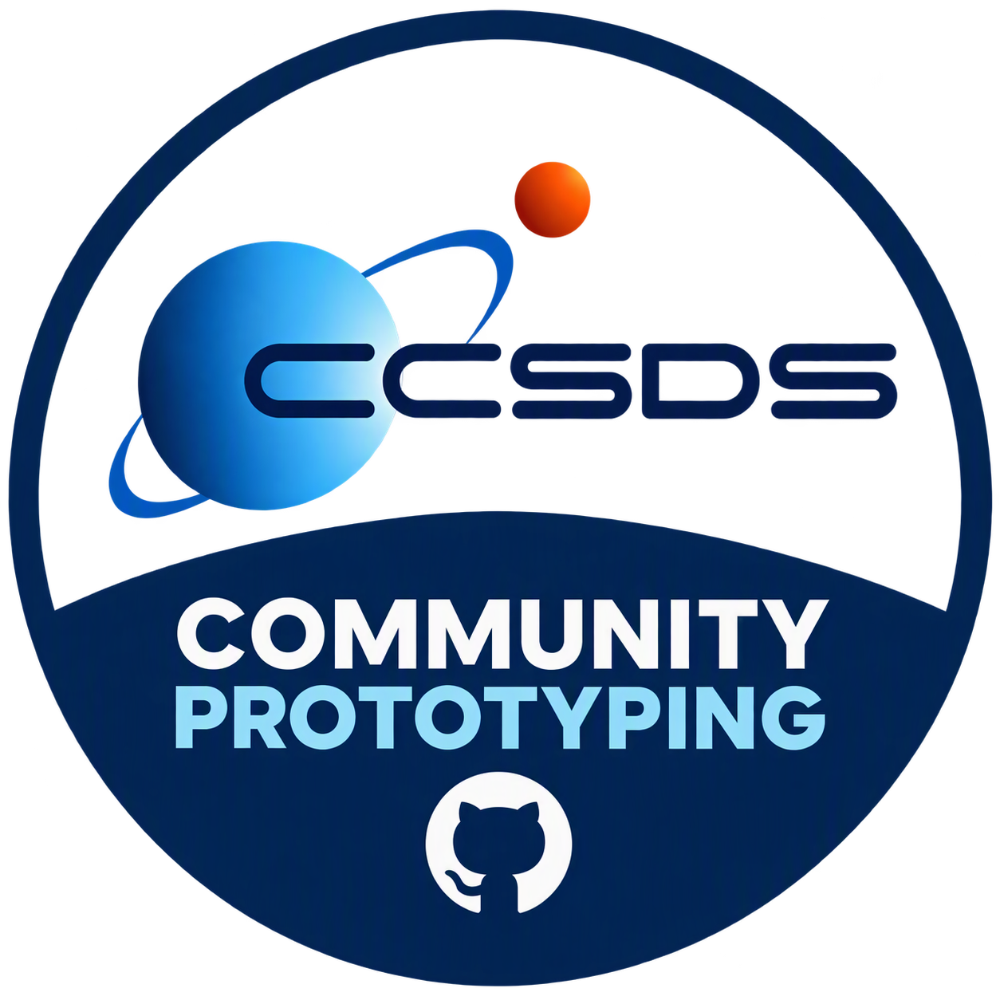

  

# CCSDS Community Prototyping

**A community hub for interoperability testing of independent implementations
of CCSDS standards.**

This repository collects links, test resources and interoperability information
for prototypes and open implementations of
[CCSDS](https://ccsds.org/) standards.

The goal is simple:

> **Implement independently. Test together. Improve the standards.**

Implementers are encouraged to use this repository to find other
implementations, exchange test vectors, perform cross-implementation testing,
and openly discuss implementation challenges.

---

# CCSDS Prototype Implementations

Implementations known to have participated in community interoperability
testing are listed below.

| CCSDS Standard / Protocol | Implementation | Language / Platform | Interoperability |
|---|---|---|---|
| LunaNet LSIS-AFS | **[LunaLink](https://github.com/luar-space/lunalink)** | C++20 / Python | ✅ Tested with independent implementations |
| _CCSDS xxx.x_ | _https://github.com/_ | _Language_ | _Status_ |
| _CCSDS xxx.x_ | _https://github.com/_ | _Language_ | _Status_ |

### LunaLink

**[luar-space/lunalink](https://github.com/luar-space/lunalink)** is an
open-source reference implementation of the **LunaNet Signal-In-Space
Recommended Standard for the Augmented Forward Signal (LSIS-AFS V1.0)**.

LunaLink was the winner of the first ESA CCSDS Protocol Implementation
Competition and provides test vectors and interoperability facilities for
cross-checking independent implementations.

---

## Implementation Challenges & Feedback to CCSDS

Implementers of CCSDS standards are strongly encouraged to **raise public
GitHub Issues when they encounter implementation challenges**, including
ambiguities, different possible interpretations, interoperability problems,
missing implementation guidance or other practical issues with a standard.

The community is invited to discuss these issues openly and, where possible,
develop and document common solutions.

The resulting implementation experience and community consensus can then be
**fed back into the CCSDS standardisation process**, helping to clarify and
improve the standards and, where appropriate, informing future updates of the
corresponding CCSDS books.

In this way, community prototyping provides a practical feedback loop:

> **Standard → Implementation → Interoperability testing → Community feedback → Standard improvement**

---

## What Belongs Here?

Community contributions may include:

- links to CCSDS protocol implementations;
- shared test vectors and reference datasets;
- interoperability test procedures and results;
- implementation challenges and proposed solutions;
- validation and comparison tools; and
- lessons learned that may improve future CCSDS book updates.

The emphasis is on **independent implementations**. The aim is not to create
one reference code base, but to demonstrate that different implementations
of the same standard work together.

---

## Community Prototyping Activities

The first community prototyping activity was the
[ESA CCSDS Protocol Implementation Competition](https://esa-competition.amsat-uk.org/about),
organised with ESA, CCSDS, Goonhilly Earth Station, AMSAT-UK and AMSAT-DL.

It provided an initial opportunity for the community to develop open
implementations and collaborate on testing. This repository builds on that
experience as a persistent home for CCSDS community prototyping and
interoperability activities.

---

## Contributing

Implemented a CCSDS standard? Found an implementation challenge? Tested two
independent implementations against each other?

**Please contribute.**

- **Open an Issue** to discuss implementation challenges, ambiguities or
  interoperability findings.
- **Open a Pull Request** to add an implementation, test vectors, tools or
  interoperability results.

Projects do not need to originate from a particular competition or activity.
Contributions from the wider CCSDS implementation community are welcome.

---

## Disclaimer

This is a community prototyping and interoperability-testing resource.
Inclusion of an implementation, discussion or proposed solution does not
constitute CCSDS or ESA certification, qualification or endorsement.

The applicable official CCSDS publications remain the authoritative
specifications.
